<p align="center">
  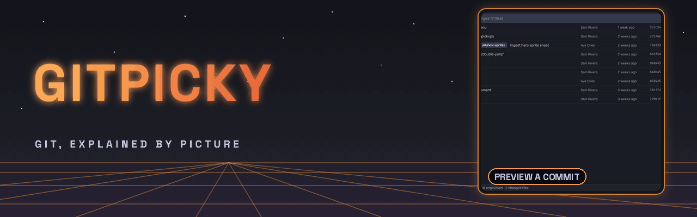
</p>

<p align="center">
  
  
  
  
  
  
</p>

<p align="center">
  <a href="#what-it-does">What it does</a> ·
  <a href="#see-it-in-action">See it in action</a> ·
  <a href="#install">Install</a> ·
  <a href="#use-it-with-an-ai-assistant">AI assistant</a> ·
  <a href="#building-installers">Build</a> ·
  <a href="#development">Development</a> ·
  <a href="#roadmap">Roadmap</a>
</p>

<table>
<tr>
<td width="52%">
  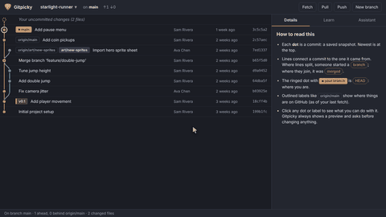
</td>
<td>

### Git, explained by picture

Gitpicky draws your repository's history as a tree you can read, explains every git word in
plain English, and shows you what a change will do **before** it happens.

Ask an AI assistant like Claude to make a change in your own words, and it shows up in Gitpicky
as a preview you approve or reject. Nothing touches your repo without your click.

The name is a nod to *nitpicky*: pick exactly the change you want, nothing more.

</td>
</tr>
</table>

> [!NOTE]
> Gitpicky is for people who use git but don't think in git: artists, designers, writers,
> students, and developers who learned just enough commands to get by.

## What's new

| Version | Highlights |
| --- | --- |
| **0.1.0** | History picture, previews for 19 kinds of change, a 38-term glossary, an MCP server with in-app approvals, fixing commit authors and co-authors, installers for Windows, macOS and Linux |

## What it does

- **Finds your projects.** A repository browser lists every repo in your project folders, and a
  recent-repositories dropdown makes switching one click instead of a folder dialog.
- **Draws the history.** Every commit is a dot, each line of work gets its own color, and labels
  show where branches, tags, GitHub's copy (`origin/…`) and HEAD ("you are here") point. Edits you
  haven't committed yet show as a dashed dot on top.
- **Previews every change.** Before anything runs you see what will happen in plain words, the
  exact git commands and why each is needed, a risk level, warnings such as predicted merge
  conflicts, and the history redrawn as it will look afterwards.
- **Explains as you go.** Hover a label for a one-line explanation, or search the **Learn** tab:
  38 git terms with analogies, the usual command, and warnings about the risky ones.
- **Fixes who gets credit.** Change the author of commits made with the wrong email, or remove
  `Co-authored-by` lines. Gitpicky spells out whose credit changes, whether the commits are
  already on GitHub, and what that means for anyone else using the branch.
- **Works with your AI assistant.** The bundled MCP server lets Claude (or any MCP client) read
  the repo, explain terms, preview changes, and *propose* them for you to approve.

### Every change goes through a plan

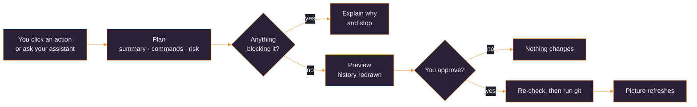

<details>
<summary><b>All 19 changes and their risk levels</b></summary>

Risk levels come from the planner (`src/core/operations.ts`) and can rise with the repo's state,
for example uncommitted edits or commits that are already pushed.

| Change | What it does | Risk |
| --- | --- | --- |
| Commit | Save picked files (or everything) as a snapshot | Safe |
| Stash / Stash pop | Set uncommitted edits aside, then bring them back | Safe |
| Discard changes | Throw away uncommitted edits | Can lose work |
| Create branch | New label at any commit, switch to it or not | Safe |
| Switch | Move to a branch, a remote branch, or a commit | Safe, careful with edits |
| Rename / delete branch | Delete refuses unmerged work unless forced | Safe, or can lose work |
| Merge | Fast-forward or merge commit, with conflict prediction | Safe, careful on conflicts |
| Undo last commit | Take it back but keep the changes | Be careful |
| Revert | New commit that undoes an old one | Safe |
| Reset | Move the branch back (soft, mixed or hard) | Be careful, hard can lose work |
| Abort | Cancel an unfinished merge, rebase, cherry-pick or revert | Be careful |
| Cherry-pick | Copy one commit onto your branch | Safe |
| Tag | Permanent label, plain or annotated | Safe |
| Fetch / Pull / Push | Sync with GitHub. Never force pushes | Safe, careful with edits |
| Fix authors | Change author, remove co-authors, with a backup | Be careful, can lose work if pushed |

</details>

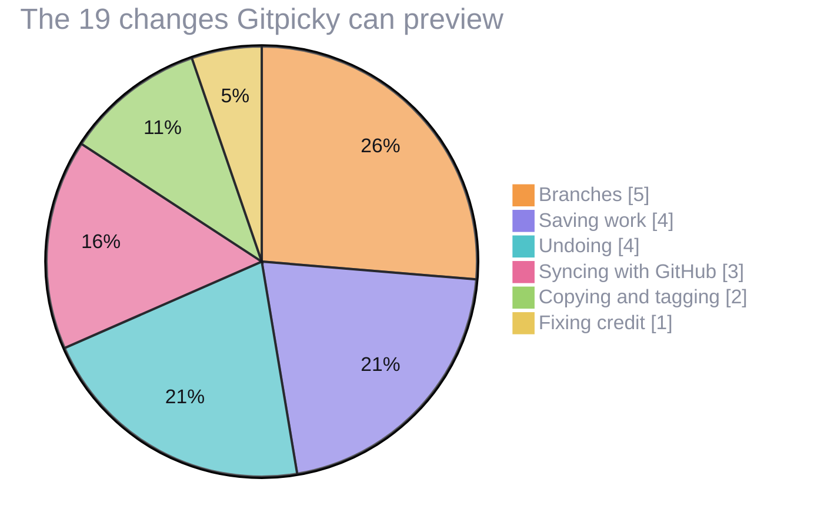

## See it in action

Every clip is the real app, recorded clicking through a demo project (see
[Recording the README media](#recording-the-readme-media)).

<table>
<tr>
<td align="center">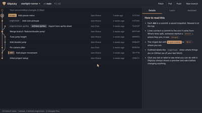<br><b>Commit</b>: pick files, preview, approve</td>
<td align="center">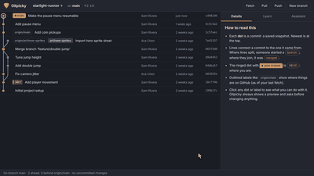<br><b>Merge</b>: see the merge commit before it exists</td>
</tr>
<tr>
<td align="center">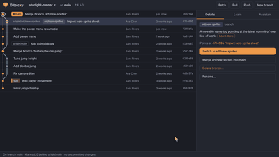<br><b>Fix authors</b>: wrong email and co-authors, fixed</td>
<td align="center">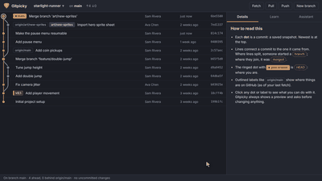<br><b>Assistant</b>: Claude asks, you approve</td>
</tr>
<tr>
<td align="center">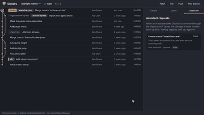<br><b>Learn</b>: every git word in plain English</td>
<td align="center">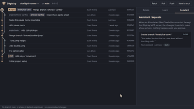<br><b>Find projects</b>: every repo in your folders</td>
</tr>
</table>

<p align="center">
  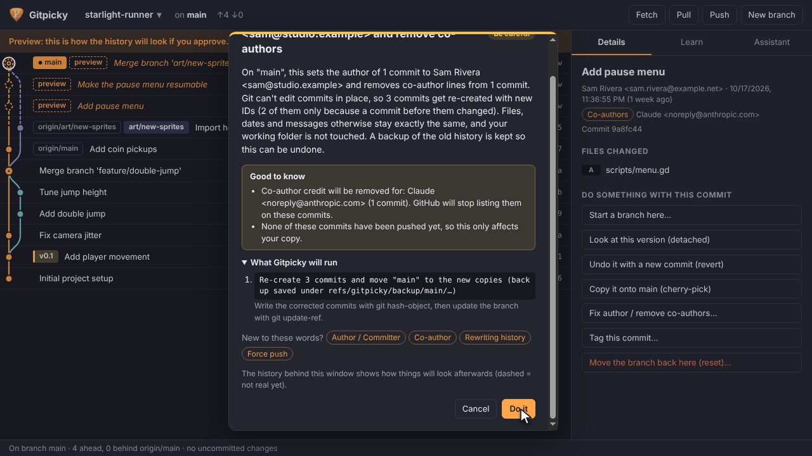<br>
  <sub>Before rewriting history, Gitpicky spells out whose credit changes and what that means for anyone else.</sub>
</p>

<details>
<summary><b>How to read the picture</b></summary>

| You see | It means |
| --- | --- |
| A dot | A commit: a saved snapshot. Newest is at the top |
| Lines splitting | Someone started a branch there |
| Lines joining at a ringed dot | A merge |
| The dot with a white ring | HEAD: where you are |
| Orange label with a dot | The branch you're on |
| Outlined label like `origin/main` | Where that branch is on GitHub, as of your last fetch |
| Notched label like `v0.1` | A tag |
| Dashed dots and lines | A preview: not real until you approve |

</details>

## Install

You need [Node.js](https://nodejs.org) 20 or newer and [Git](https://git-scm.com) 2.38 or newer
(older Git works; merge-conflict prediction needs 2.38).

```bash
git clone https://github.com/<owner>/Gitpicky.git
cd Gitpicky
npm install
npm start
```

Click **Find a repository…** to see every repository in the folders you keep projects in, grouped
by folder, with each one's current branch. Gitpicky finds common project folders on its own (and
the folders your recent repositories live in); add or remove folders in the left column, search by
name, folder or branch, and open one with a click or <kbd>Enter</kbd>. You can also choose a single
folder, or drop one on the window.

After that, switch projects from the dropdown under the repository name. It remembers your last 12
repositories with their current branch, and **Browse all repositories…** at the bottom opens the
full list again.

| Shortcut | Does |
| --- | --- |
| <kbd>Ctrl</kbd>+<kbd>O</kbd> (<kbd>⌘</kbd>+<kbd>O</kbd> on a Mac) | Recent repositories dropdown |
| <kbd>Ctrl</kbd>+<kbd>Shift</kbd>+<kbd>O</kbd> (<kbd>⇧</kbd>+<kbd>⌘</kbd>+<kbd>O</kbd>) | Browse all repositories |
| <kbd>↑</kbd> <kbd>↓</kbd> <kbd>Enter</kbd> | Pick from either list |
| <kbd>Esc</kbd> | Close a list or preview without changing anything |

Gitpicky reopens the last repository on launch and refreshes on its own when files change.

> [!TIP]
> New to a word in a preview? Click its chip under **New to these words?** to jump straight to the
> glossary.

## Use it with an AI assistant

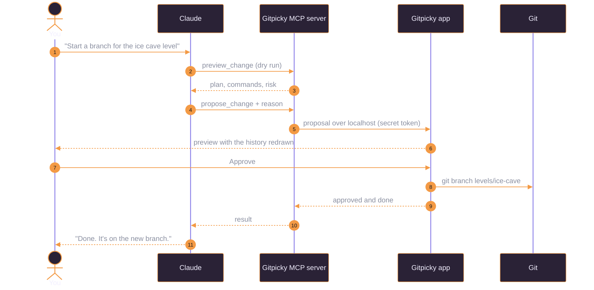

Open Gitpicky's **Assistant** tab and click **Copy config**. It fills in the right path for your
copy. Paste it into your assistant's MCP settings (for Claude Desktop: **Settings → Developer →
Edit Config**) and restart the assistant:

```json
{
  "mcpServers": {
    "gitpicky": {
      "command": "node",
      "args": ["C:\\path\\to\\gitpicky-mcp.js"]
    }
  }
}
```

<details>
<summary><b>The 7 tools your assistant gets</b></summary>

| Tool | What it does | Needs the app? |
| --- | --- | --- |
| `get_repo_overview` | Branch, uncommitted changes, sync status, branches, tags and a drawing of recent history | No |
| `show_history` | Text drawing of the commit graph | No |
| `explain_git_term` | Plain-English explanation of a git word | No |
| `preview_change` | Dry run: plan, commands, risk, blockers. Changes nothing | No |
| `propose_change` | Sends a change to Gitpicky for approval and reports the outcome | Yes |
| `check_proposal` | Checks on (or keeps waiting for) a proposal | Yes |
| `open_in_gitpicky` | Shows a repository in the app | Yes |

</details>

### How it stays safe

- Every change, yours or the assistant's, goes through the same planner, which refuses invalid
  or dangerous requests: deleting unmerged work, pushing when behind, anything during an
  unfinished merge.
- The app and the MCP server talk over `127.0.0.1` only, with a random port and a secret token in
  `~/.gitpicky/bridge.json`. Requests from web pages are refused.
- There is no force push, ever.
- Destructive actions need an extra "I understand the risks" tick.
- Before rewriting history, Gitpicky saves the old branch tip under `refs/gitpicky/backup/…`, so
  you can always go back.

> [!WARNING]
> Fixing authors on commits that are already on GitHub rewrites shared history. Gitpicky warns
> you and won't push for you; only force push branches nobody else is using, or agree on it with
> them first.

## Building installers

**On Windows, the easy way:** double-click `Build-Windows.cmd`. It checks for Node and Git,
installs dependencies, runs the tests, builds the installer and opens the `release` folder.

| On | Run | You get (in `release/`) |
| --- | --- | --- |
| Windows | `npm run dist:win` | `.exe` installer (x64 and arm64) and a portable `.zip` |
| macOS | `npm run dist:mac` | `.dmg` and `.zip` (universal: Intel and Apple Silicon) |
| Linux | `npm run dist:linux` | `.AppImage` (GitHub Actions also builds a `.deb`) |

macOS installers can only be built on a Mac, so GitHub Actions builds all three:

- **Every push to `main`:** tests run on Windows, macOS and Linux, then installers for all three
  are attached to the run under **Artifacts**.
- **A version tag** (`git tag v0.1.0`, then `git push origin v0.1.0`): the same, plus a draft
  GitHub Release with the installers attached.

<details>
<summary><b>First launch on an unsigned build</b></summary>

The builds aren't code-signed yet, so:

- **Windows:** SmartScreen may say "Windows protected your PC". Click **More info → Run anyway**.
- **macOS:** right-click the app and choose **Open** the first time. If macOS says the app is
  damaged, run `xattr -cr /Applications/Gitpicky.app`.
- **Building on Windows:** if electron-builder fails with "Cannot create symbolic link", turn on
  **Developer Mode** in Windows Settings (or run the terminal as administrator).

</details>

## Development

```bash
npm test          # unit and integration tests, using throwaway git repos
npm run typecheck # strict TypeScript for the app and the window code
npm run build     # compile to dist/
npm run dist      # build an installer for the system you're on
```

```
src/
  core/      Pure TypeScript: reading git, graph layout, glossary, change plans, author rewrites
  app/       Electron main process: window, file watcher, MCP bridge, proposals
  renderer/  The window: history drawing, side panels, dialogs (no framework)
  mcp/       The MCP server (stdio)
assets/icons Icon candidates (SVG sources and PNG renders)
build/       Installer resources (app icon)
tools/       readme-media: records and builds the README's GIFs
test/        Vitest suites
```

### Recording the README media

Everything under `.github/readme/` is the real app, recorded by two scripts in
`tools/readme-media/`:

- `capture.mjs` builds a few demo repositories with made-up people in a temp folder, opens the app
  with Playwright (using its own settings folder, so your recent list is never touched or shown),
  clicks through each scene listed in `media.json`, and saves every frame. It also renders the
  banner background from `banner.html`.
- `build_media.py` turns those frames into the banner, hero, clips and stills.

```bash
npm run build
npm run readme:capture   # records tools/readme-media/.work/frames
npm run readme:contact   # numbered contact sheet, for checking each scene fits its slot
npm run readme:build     # writes .github/readme/ (needs Python and Pillow)
```

Scenes, their order, the banner text and crop, and the GIF sizes and speeds all live in
`media.json`.

## Roadmap

- [x] History picture with branch lanes and labels
- [x] Previews for every change, with risk levels and blockers
- [x] Glossary and in-context explanations
- [x] MCP server with in-app approvals
- [x] Fix commit authors and co-authors
- [x] Installers for Windows, macOS and Linux
- [ ] Pick the final icon (guitar pick or tweezers)
- [ ] File diffs in the details panel
- [ ] Guided conflict resolution
- [ ] Visual rebase and squash with previews
- [ ] Code signing and auto-update

## License

MIT © The Gitpicky contributors. The README font, Space Grotesk, is under the
[SIL Open Font License](tools/readme-media/fonts/OFL.txt).
