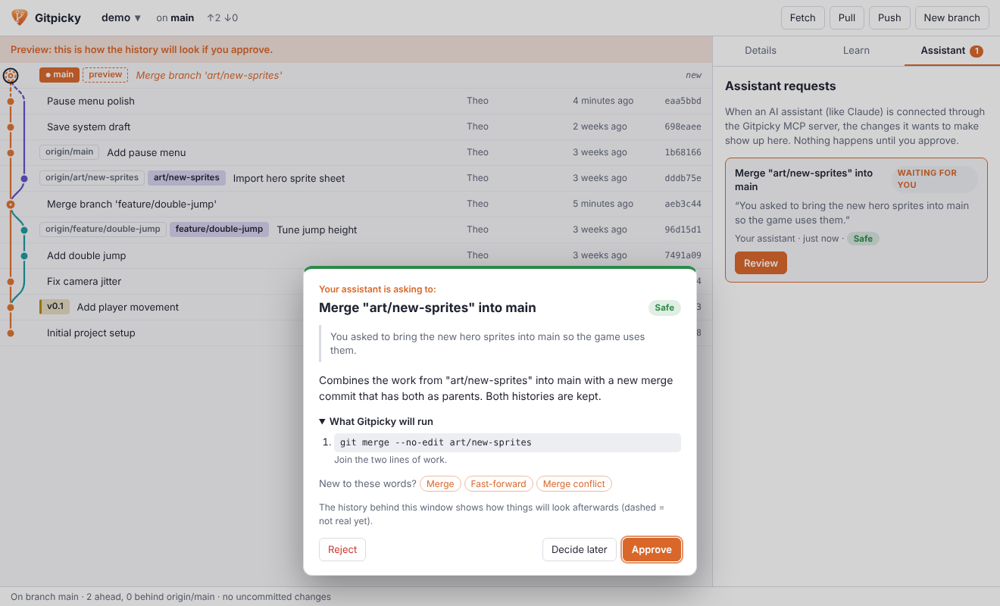
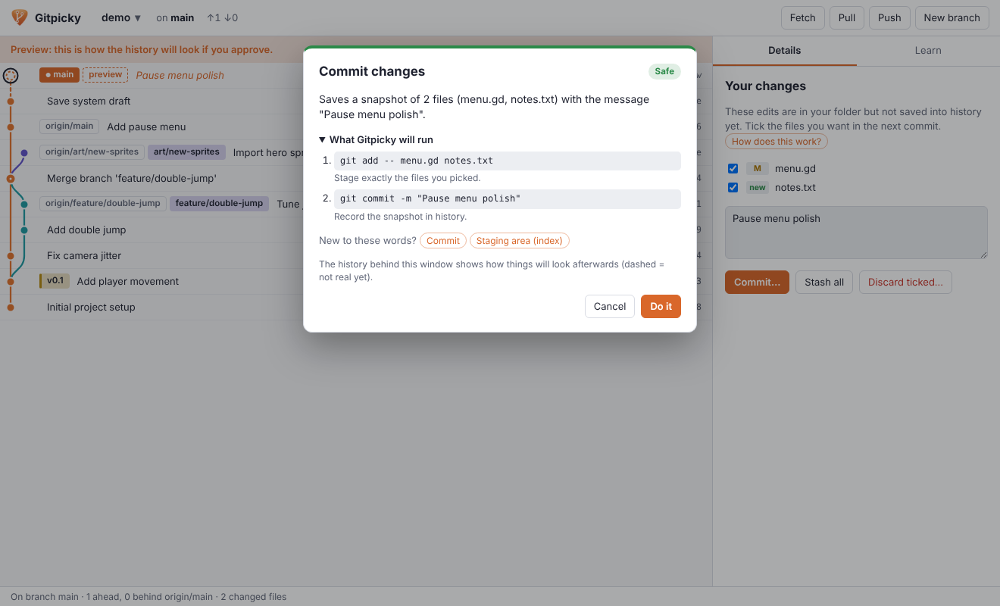
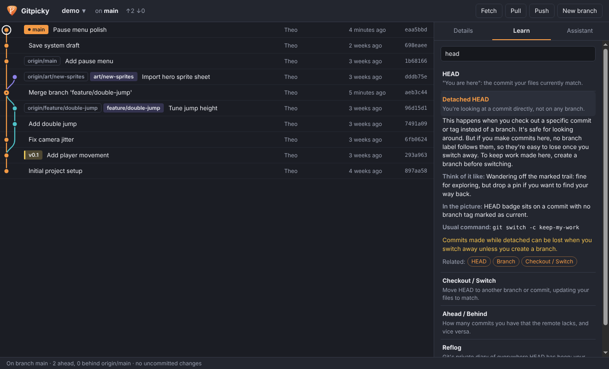

# Gitpicky

**Git, explained by picture.** Gitpicky draws your repository's history as a tree you can read,
explains every git word in plain English, and shows you what a change will do *before* it happens.
It also ships an MCP server, so you can ask an AI assistant (like Claude) to make repo changes in your
own words and approve each one in the app.

The name is a nod to *nitpicky*: pick exactly the change you want, nothing more.



> Status: early development (v0.1). Built with Electron + TypeScript. Windows-first, but runs on macOS and Linux too.

## Who it's for

People who use git but don't think in git: artists, designers, writers, students, and developers who
learned just enough commands to get by. If you've ever wondered what "detached HEAD" means or whether
`reset --hard` is going to eat your work, this is for you.

## What it does

- **Draws the history.** Every commit is a dot, branches get their own colored lines, and labels show
  where each branch, tag, remote branch and HEAD ("you are here") point. Uncommitted edits show up as a
  dashed dot on top.
- **Explains as you go.** Hover any label for a one-line explanation. The **Learn** tab is a searchable
  glossary of 35 git terms with analogies, the usual command, and warnings about the risky ones.
- **Previews every change.** Commit, branch, switch, merge, revert, cherry-pick, reset, stash, tag,
  push, pull and more. Before anything runs you see:
  - what will happen, in plain words,
  - the exact git commands and why each is needed,
  - a risk level (Safe / Be careful / Can lose work),
  - warnings such as predicted merge conflicts, and anything blocking it,
  - the history redrawn as it will look afterwards.
- **Works with your AI assistant.** The bundled MCP server lets an assistant read the repo, explain
  terms, preview changes, and *propose* them. Proposals pop up in Gitpicky with the assistant's reason;
  you approve or reject. Nothing changes without your click.

| Commit preview | Learn tab (dark theme) |
| --- | --- |
|  |  |

## Getting started

You need [Node.js](https://nodejs.org) 20 or newer and [Git](https://git-scm.com) 2.38 or newer
(older Git works, but merge-conflict prediction needs 2.38).

```bash
git clone https://github.com/<owner>/Gitpicky.git
cd Gitpicky
npm install
npm start
```

Click **Open a repository…** and pick any folder that uses git. Gitpicky remembers recent repos and
refreshes on its own when files change.

## Connect an AI assistant (MCP)

Build once with `npm run build`, then add Gitpicky to your assistant's MCP config. For Claude Desktop,
open **Settings → Developer → Edit Config** and add:

```json
{
  "mcpServers": {
    "gitpicky": {
      "command": "node",
      "args": ["C:\\path\\to\\Gitpicky\\dist\\mcp\\server.js"]
    }
  }
}
```

Restart the assistant, keep Gitpicky open, and ask things like:

- "What's going on in my repo at C:\Projects\MyGame? Explain it simply."
- "Make a branch for the forest level and commit what I have so far."
- "I committed to the wrong branch. Help me fix it."

### Tools the assistant gets

| Tool | What it does | Needs the app? |
| --- | --- | --- |
| `get_repo_overview` | Branch, uncommitted changes, sync status, branches, tags and a drawing of recent history | No |
| `show_history` | Text drawing of the commit graph | No |
| `explain_git_term` | Plain-English explanation of a git word | No |
| `preview_change` | Dry run: plan, commands, risk, blockers. Changes nothing | No |
| `propose_change` | Sends a change to Gitpicky for approval and reports the outcome | Yes |
| `check_proposal` | Checks on (or keeps waiting for) a proposal | Yes |
| `open_in_gitpicky` | Shows a repository in the app | Yes |

### How it stays safe

- Every change goes through the same planner the app uses, which refuses invalid or dangerous
  requests (unmerged branch deletion, pushing when behind, anything during an unfinished merge…).
- The app and the MCP server talk over `127.0.0.1` only, using a random port and a secret token stored
  in `~/.gitpicky/bridge.json`. Requests from web pages are refused.
- There is no force push, ever.
- Destructive actions (hard reset, discarding changes, deleting unmerged work) need an extra
  "I understand" tick.

## Development

```bash
npm test          # unit + integration tests (uses throwaway git repos)
npm run typecheck # strict TypeScript for both the app and the window code
npm run build     # compile to dist/
```

```
src/
  core/      Pure TypeScript: reading git, graph layout, glossary, change plans
  app/       Electron main process: window, file watcher, MCP bridge, proposals
  renderer/  The window: history drawing, side panels, dialogs (no framework)
  mcp/       The MCP server (stdio)
assets/icons Icon candidates (SVG sources + PNG renders)
test/        Vitest suites
```

`scripts/render-icons.mjs` re-renders the icon PNGs from their SVG sources (needs Playwright installed).

## Roadmap

- Windows installer (electron-builder) and auto-update
- Pick the final icon (guitar pick vs. tweezers)
- File diffs in the details panel
- Guided conflict resolution
- Visual rebase and squash with previews

## License

MIT © The Gitpicky contributors
